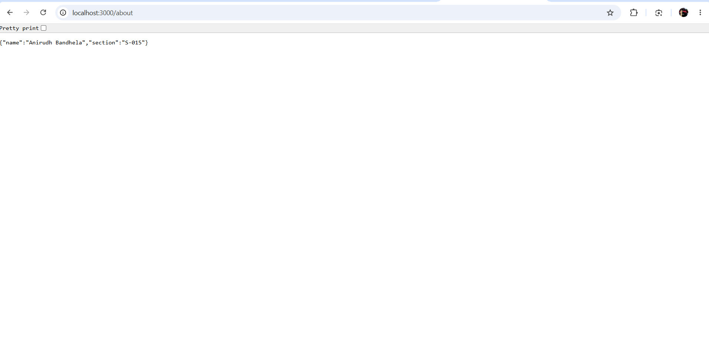
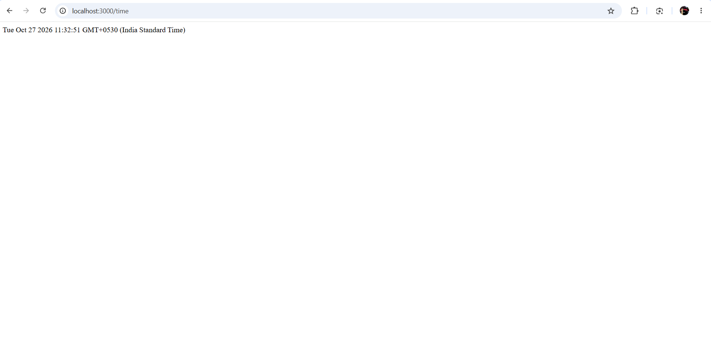
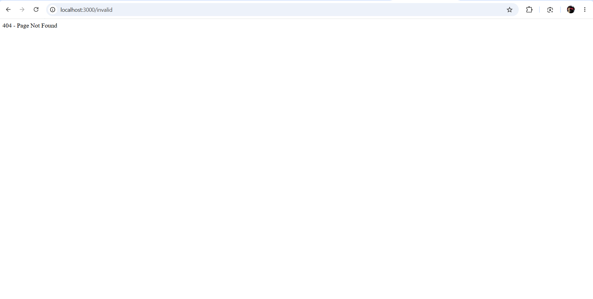

# Lab 1: Node.js and Express Server

**Deployment URL:** Pending deployment

## Student Details

- **Name:** Anirudh Bandhela
- **Registration Number:** 252U1R1025
- **Section:** C.S.E-CORE-2A, 223
- **Subject:** Backend Development Fundamentals
- **Lab:** 1 - Node.js and Express Server
- **Faculty:** Shiva Sai Teja

## Aim

To create a web server using Node.js and Express.js, implement GET routes, return JSON data, display the current date and time, and handle invalid routes with a 404 status code.

## Technologies Used

- Node.js
- Express.js
- npm
- JavaScript
- Visual Studio Code

## Project Structure

```text
node-express-lab/
├── http-server.js
├── server.js
├── package.json
├── package-lock.json
├── README.md
└── screenshots/
    ├── home.png
    ├── about.png
    ├── time.png
    └── not-found.png
```

## Installation

1. Install Node.js from https://nodejs.org/
2. Clone this repository:

   ```bash
   git clone https://github.com/anirudh2007-cell/node-express-lab.git
   ```

3. Enter the project directory:

   ```bash
   cd node-express-lab
   ```

4. Install dependencies:

   ```bash
   npm install
   ```

## Execution

### Plain Node.js HTTP Server

```bash
node http-server.js
```

Open http://localhost:3000 to see the `Hello` response.

Stop the server with Ctrl+C before starting the Express server.

### Express Server

```bash
node server.js
```

Open the endpoints listed below in your browser.

## API Endpoints

| Method | Endpoint | Description | Status |
|--------|----------|-------------|--------|
| GET | / | Displays the welcome message | 200 OK |
| GET | /about | Returns student details as JSON | 200 OK |
| GET | /time | Returns the current date and time | 200 OK |
| GET | /invalid | Returns a not-found message | 404 Not Found |

## Screenshots

### Home Route


### About Route



### Time Route



### 404 Not Found



## Concepts Learned

- Creating a Node.js project using npm.
- Understanding package.json and node_modules.
- Creating a server with the built-in HTTP module.
- Building routes using Express.js.
- Returning text and JSON responses.
- Using HTTP status codes 200 and 404.
- Generating the current date and time with JavaScript.

## Notes

- Do not commit the node_modules folder.
- Do not commit or share any .env file.
- Run only one server on port 3000 at a time.
- The deployment URL will be added after successful deployment.

## Result

Successfully implemented a basic Node.js HTTP server and an Express server with three GET routes and a 404 handler.
